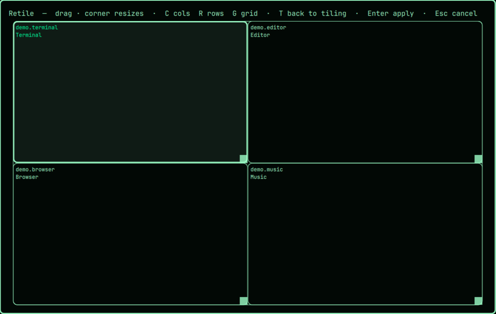
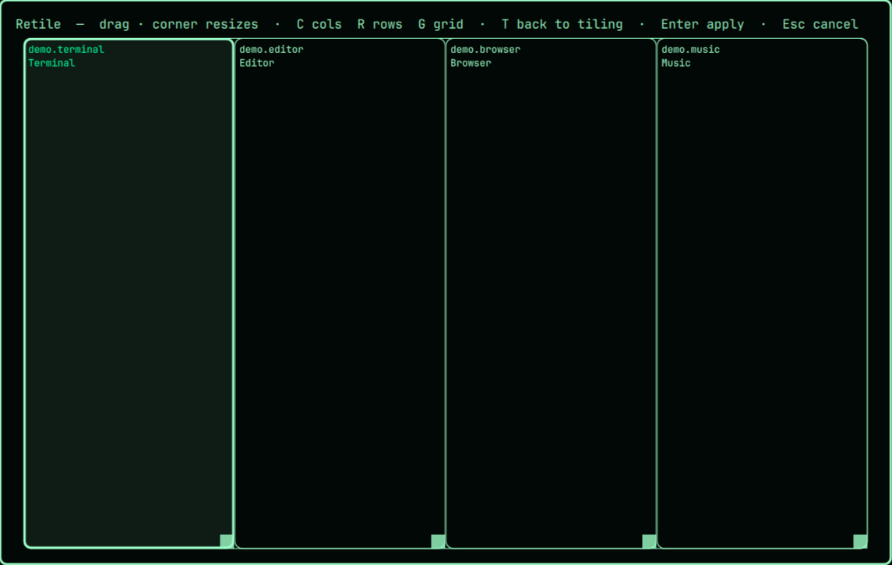
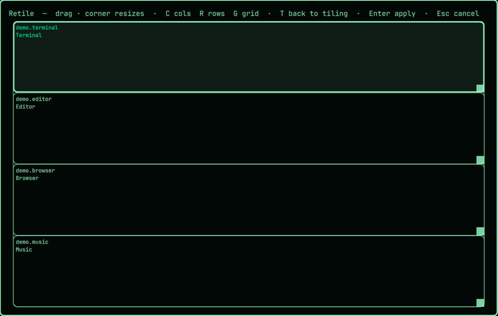

# Retile

An Omarchy overlay plugin. Lays the current workspace's windows out as draggable
tiles, then applies the arrangement with `hyprctl`. Nothing changes until you
press Enter.


- **Drag** a tile to move it. Drop it on another tile to swap them, or the other
  tile is pushed to the nearest open space. If there's no room, your tile goes
  back. Tiles never overlap.
- **Resize** by pulling a tile's bottom-right corner (it can't push into a neighbour).
- `C` columns, `R` rows, `G` grid presets
- `Enter` apply. Windows are floated at the chosen positions and sizes.
- `T` hand every window on the workspace back to the tiling layout
- `Esc` cancel

If the windows already overlap when you open it, it starts from a grid.

## Presets

| Grid (`G`) | Columns (`C`) | Rows (`R`) |
|---|---|---|
|  |  |  |

## Install

```bash
omarchy plugin add https://github.com/jram0421/omarchy-retile.git --enable
```

Then bind a key in `~/.config/hypr/bindings.lua`:

```lua
o.bind("SUPER + ALT + R", "Retile windows", "omarchy-shell shell toggle jram0421.retile")
```

Plugins can't register keybindings themselves, so this step is manual.

## Requirements

- Omarchy with the shell plugin system (`omarchy plugin`), on Hyprland 0.56 or
  newer. Apply uses Hyprland's `hl.dsp.window.*` Lua dispatchers through
  `hyprctl --batch`.
- `hyprctl` (ships with Hyprland). No other dependencies, no network access,
  no background services, no installer, and nothing is written outside this folder.
- It never edits your Hyprland or Omarchy config. Add the keybinding yourself.

## Removal

```bash
omarchy plugin remove jram0421.retile
```

Then delete the `SUPER + ALT + R` line from `~/.config/hypr/bindings.lua`.
Windows you applied a layout to stay floating; press `T` in the overlay first
(or re-tile them yourself) if you want them back in the tiling layout.

## Notes

- Tested on Hyprland 0.56.2.
- Strings live in `i18n/`; `en.json` is the only catalog so far. Add
  `<code>.json` files named after Omarchy's language codes to translate.
- Validate with `omarchy plugin validate .`.
- After editing the QML in place, restart the shell (`omarchy restart shell`)
  to be sure the running overlay picks it up. The hot reload did not always
  apply to an already-loaded overlay.

MIT licensed.
